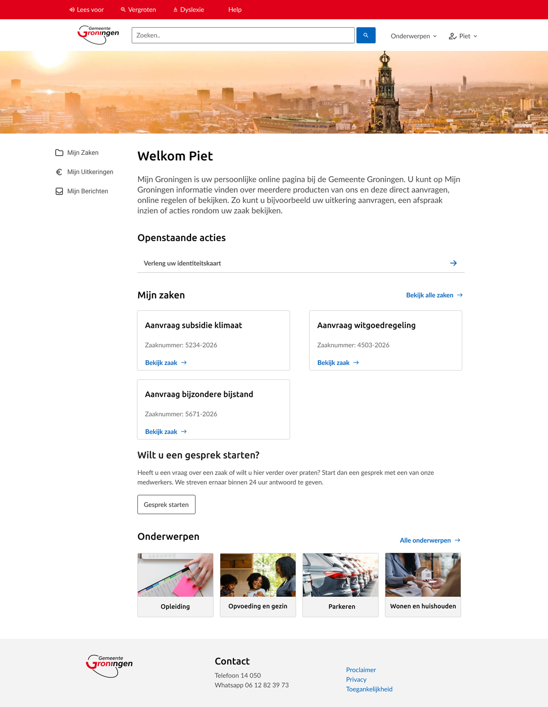
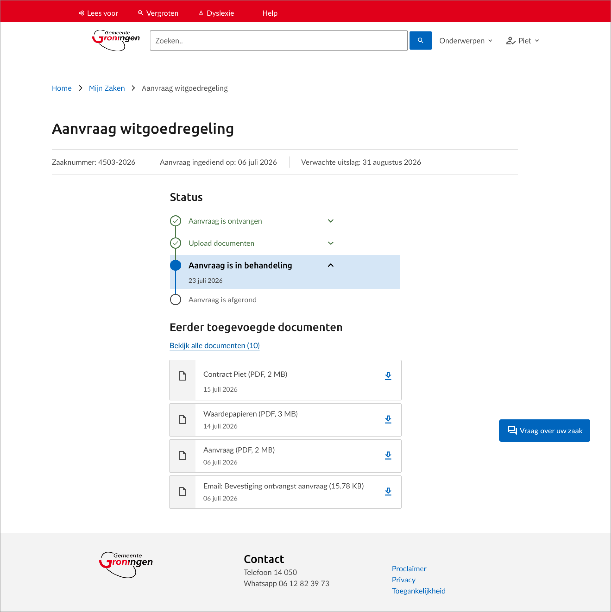
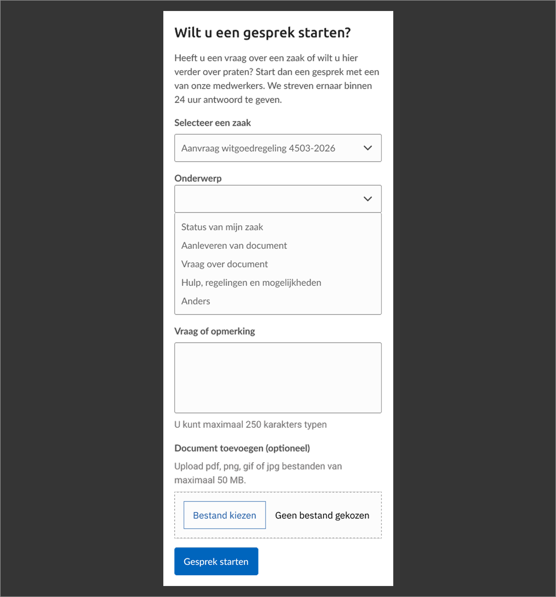
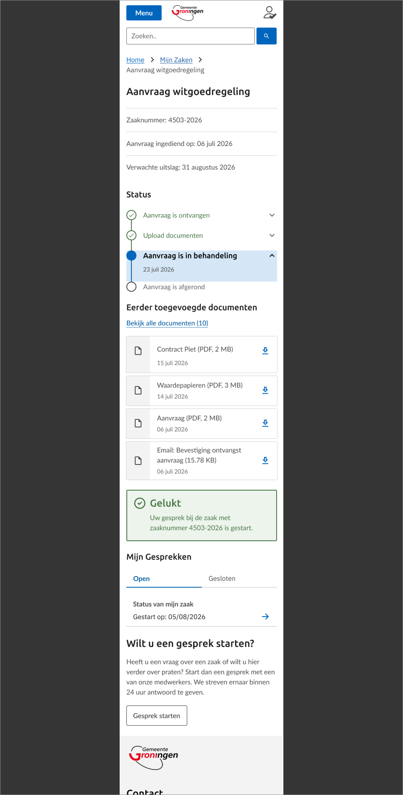
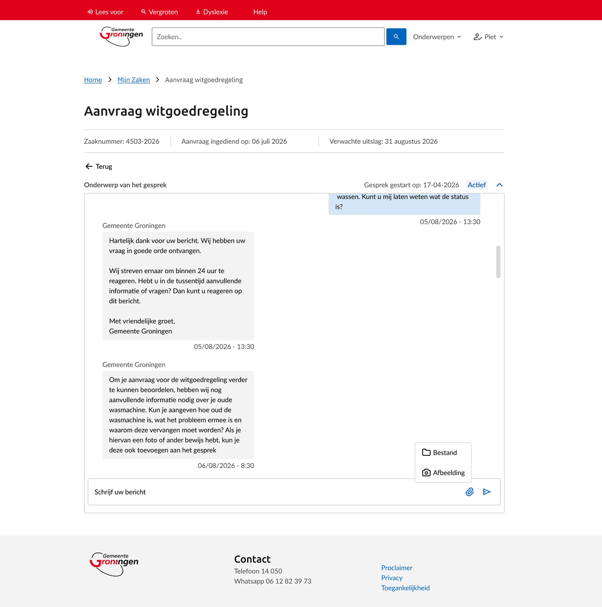

<!-- @license CC0-1.0 -->

# Onderzoek Mijn Gesprekken in Open Inwoner Platform (OIP) – Mijn Omgeving

## Doel van het onderzoek

We willen onderzoeken of deze manier van digitaal communiceren aansluit bij de behoeften en verwachtingen van inwoners. Daarbij kijken we onder andere in welke situaties inwoners MijnGesprekken zouden gebruiken, wat zij verwachten van een digitaal gesprek met de gemeente en hoe deze manier van communiceren zich verhoudt tot bestaande contactkanalen, zoals de telefoon, e-mail of WhatsApp. Ook onderzoeken we of de functionaliteit van MijnGesprekken in de MijnOmgeving duidelijk, logisch en begrijpelijk is voor inwoners.

## Onderzoeksvraag

In dit onderzoek zijn hoofdvragen met elk een aantal subvragen gedefinieerd. Hierin maken wij een onderscheid tussen het algemene concept van een gesprek voeren met de gemeente en het daadwerkelijk gebruik/test van de functionaliteit MijnGesprekken binnen de MijnOmgeving MijnGroningen.

### Algemeen concept van gespreksfunctie met de gemeente

- Welke verwachtingen hebben inwoners van een digitaal gesprek met de gemeente?
- Hoe verwachten inwoners dat een digitaal gesprek is opgebouwd en werkt?
- Welke zorgen of drempels ervaren inwoners bij het voeren van een digitaal gesprek met de gemeente?
- Wat hebben inwoners nodig om vertrouwen te hebben in deze manier van communiceren?
- Wat is de geschikte term voor deze functionaliteit? Hoe zal je het noemen?
- Voor welke soorten vragen of situaties zouden inwoners een digitaal gesprek willen gebruiken?
- Welke informatie willen inwoners tijdens een digitaal gesprek kunnen terugvinden of uitwisselen (bijvoorbeeld documenten of eerdere berichten)?
- Voor welke onderwerpen vinden inwoners een digitaal gesprek wel of juist niet geschikt?
- Hoe verhoudt MijnGesprekken zich volgens inwoners tot andere contactkanalen, zoals bellen, e-mail en WhatsApp?
- Welke voordelen zien inwoners van een digitaal gesprek ten opzichte van bestaande contactkanalen?
- Welke gesprekken zou een inwoner via MijnGesprekken niet voeren, en via andere kanalen wel?
- Welke verwachtingen hebben inwoners van de dienstverlening binnen MijnGesprekken, zoals reactietijden, duidelijkheid en persoonlijk contact?
- Welke reactietermijn verwachten inwoners bij een digitaal gesprek met de gemeente?
- Hoe verwachten inwoners op de hoogte te worden gehouden van nieuwe berichten of reacties?

### Gebruik in de MijnOmgeving / designs

- Kunnen inwoners de gespreksfunctie vinden op MijnGroningen?
- Hoe navigeren inwoners naar het gesprek?
- Hoe gebruikt een inwoner de gespreksfunctie?
- Is het duidelijk dat een gesprek alleen onder een zaak kan hangen?
- Is het duidelijk dat inwoners een onderwerp en een zaak moeten kiezen?
- Wat verwachten inwoners onder het onderwerp ‘anders’?
- Willen ze het onderwerp graag zelf definiëren?
- Is de opbouw van MijnGesprekken logisch en begrijpelijk?
- Kunnen ze het gesprek volgen, lezen en beantwoorden?
- Is het uploaden en delen van documenten eenvoudig en duidelijk?
- Kunnen inwoners gemakkelijk terugvinden wat eerder is besproken in een gesprek?

Verder hielden we ook rekening met bijvangst en inventariseerden we welke vragen of opmerkingen een inwoner heeft.

## Resultaten en inzichten

De resultaten en inzichten worden aan de hand van twee verschillende categorieën ingedeeld.

### Belangrijkste verwachtingen gespreksfunctie

- **De term ‘Gesprek’ dekt de lading niet volgens inwoners.** Inwoners denken meer aan de termen ‘chat’ of ‘bericht’. Het is belangrijk om nieuwe functionaliteiten in samenhang met bestaande functionaliteiten te onderzoeken.
- **Inwoners verwachten te communiceren met een echt persoon, niet met AI.** Bijvoorbeeld door een persoonlijke aanhef (‘Hallo Piet’) en afsluiting (‘Vriendelijke groet - naam medewerker’).
- **Een gesprek achter DigiD wordt als veilig ervaren.** De meerwaarde van deze functie ligt voor inwoners vooral in het veilig kunnen delen van gevoelige informatie, zoals inkomen, BSN, et cetera.
- **De functie wordt vooral gebruikt voor niet-urgente zaken.** Als een inwoner snel antwoord wil hebben, kiest deze voor bellen als communicatiemiddel.

### Belangrijkste inzichten gebruik designs / MijnOmgeving

- **De gespreksfunctie wordt via de homepage niet gebruikt.** Inwoners starten een gesprek via de zaakdetailpagina.

- **Als inwoners een gesprek kunnen starten via de homepage, denken ze dat deze vragen over van alles kunnen gaan.** Inwoners koppelen dit dan niet aan een zaak. Vragen die overal over gaan, zouden kunnen zijn: wanneer wordt het afval opgehaald en wat zijn de openingstijden.
- **Geen pop-upweergave gebruiken van het gesprek.** Het gesprek is dan niet vindbaar en er ontstaat verwarring op de zaakdetailpagina, in combinatie met de status. Vooral wanneer men ook documenten moet of kan toevoegen. Dit is met name het geval voor desktop. De pagina wordt dan in het geheel druk.

- **Het kiezen van onderwerpen via een selectiemenu is duidelijk.** Inwoners kiezen de juiste optie, vinden de verschillende categorieën duidelijk. Ook de categorie ‘anders’ is duidelijk.

- **Een ‘Gelukt’-melding bij het starten van een gesprek is verwarrend in combinatie met de mogelijkheid om nog een gesprek te starten.** Het gestarte gesprek zien inwoners niet. Inwoners snappen niet dat ze nog een gesprek kunnen starten terwijl ze wel de bevestiging krijgen dat het gelukt is een gesprek te starten.

- **De gespreksfunctie wordt als duidelijk ervaren.** Het voeren van een gesprek verloopt soepel. Het uploaden van een afbeelding of document aan het gesprek ook.

- **Het sluiten van het gespreksscherm is niet duidelijk.** Inwoners zien de ‘terug’-knop niet en zoeken naar een kruisje (icoon) om het scherm te kunnen sluiten. Mogelijk komt dit door de hoeveelheid en het type informatie bovenaan het scherm, zoals zaaknummer, datum van verwachte uitslag van de zaak en de startdatum van de zaak.
- **E-mailnotificaties zijn in lijn met de verwachting van inwoners. Inwoners verwachten bij een antwoord een e-mailnotificatie te krijgen.** De notificatie is duidelijk en het direct doorlinken naar het gesprek zelf is prettig.
- **Nieuwe berichten tonen in het gesprek kan duidelijker.** Inwoners lezen ook de oude berichten, omdat er visueel geen verschil is tussen oude en nieuwe berichten.

## Wat is er mee gedaan?

Op basis van de onderzoeken zijn de designs verbeterd. Onder andere de weergave van het succesvol starten van een gesprek, het sluiten van het gespreksscherm en het tonen van nieuwe berichten in een lopend gesprek.

Deze vernieuwde designs zijn besproken in de NL Design System Mijn Services community. Daarnaast zijn de designs omgezet naar het NL Design System Voorbeeld-thema, om deze op te kunnen nemen in het MijnServices-template.

Ook worden stappen gezet voor een succesvolle implementatie van het inwonersportaal. Zo werkt leverancier Roxxit aan de technische implementatie van de designs.

Vanuit dit onderzoek zijn ook onderzoeksvragen naar voren gekomen voor mogelijk vervolgonderzoek naar de MijnGesprekken-functionaliteit:

- Hoe verhoudt de functionaliteit zich tot andere bestaande MijnServices (bijvoorbeeld MijnTaken)?
- Kan de functionaliteit ook ingezet worden in een andere context dan Inkomen of gekoppeld worden aan een ander object dan MijnZaken (zoals MijnBerichten of MijnPlan)?
- Hoe kunnen afwezigheids- en out-of-officeberichten binnen MijnGesprekken worden ingezet, wat vindt de inwoner hiervan?
- Wanneer en op welke manier moeten gesprekken worden afgesloten en gearchiveerd (bijvoorbeeld bij beantwoorde vragen of inactiviteit)?
- Op welke manier kan de functionaliteit van MijnGesprekken worden gecombineerd met een AI-assistent?

Naar verwachting zullen gedurende verdere ontwikkeling, onderzoek, implementatie en evaluatie van MijnGesprekken aanvullende onderzoeksvragen ontstaan.

## Opzet onderzoek

Usability testing volgens de think-aloudmethode is gekozen om deze designs voor te leggen aan inwoners.

### Vooronderzoek

In eerste plaats zijn zaken uitgezocht waarbij verwacht wordt dat een gespreksfunctionaliteit waarde toevoegt en waar men al met de MijnOmgeving werkt. Dit bleken zaken te zijn uit het sociaal domein.

In samenwerking met collega's uit het sociaal domein is vormgegeven aan de designs die zijn opgesteld. Op basis van hun ervaringen op de werkvloer zijn uitgangspunten en keuzes gemaakt. Bijvoorbeeld de reactietermijnen, onderwerpen (categorieën) en de mogelijkheid om standaardberichten te kunnen sturen.

Hier zijn de verschillende designs op gebaseerd:

- Een desktopversie waarbij het gesprek op een aparte pagina wordt getoond.
- Een desktopversie waarbij het gesprek in een pop-up wordt getoond.

Vanuit deze desktopversies zijn ook ontwerpen gemaakt voor een mobiel scherm. Daarnaast is actief voor de designs beroep gedaan op de NL Design System Mijn Services community om de designs zo toegankelijk mogelijk vorm te geven.

### Onderzoeksfase

In totaal hebben 22 inwoners deelgenomen aan het onderzoek, verspreid over vier varianten (twee mobiel en twee desktop).

De inwoners zijn op twee verschillende manieren geworven:

1. Via een interne pool om inwoners (vijftien in totaal) met een uitkering te werven.
2. Via willekeurige inwoners (zeven in totaal), die op diverse tijdstippen en dagen zijn aangesproken in de ontvangsthal.

Alle inwoners kregen twee scenario's voorgelegd:

1. Het starten van een gesprek over hun zaak.
2. Reageren op het gesprek nadat een antwoord is gegeven door de gemeente.

## Contactinformatie

- [Jana Kloss](mailto:jana.kloss@groningen.nl) – project lead -Gemeente Groningen
- [Sirin Yildiz](mailto:sirin.yildiz@groningen.nl) – UX-researcher - Gemeente Groningen
- [Marieke Brouwer](mailto:marieke.brouwer@groningen.nl) – UX-researcher - Gemeente Groningen
- [Lidwien Lumkeman](mailto:lidwien@maykinmedia.nl) – UX-designer - Maykin

## Documentatie

- [Mijn Services](https://vng.nl/mijnservices)
- [Designs MijnGesprekken](https://www.figma.com/design/mHAIUgQDm6Y0XRNY6bwBSj/Wireframes-Mijn-Gesprek?node-id=733-22880&p=f&t=Ub0FB1ZINiH2pBmf-0)
- [Prototype mobiel button](https://www.figma.com/proto/mHAIUgQDm6Y0XRNY6bwBSj/Mijn-Gesprekken---Mijn-Services?node-id=736-25133&p=f&t=5Hoxq7MzcIJ9oqf4-0&scaling=min-zoom&content-scaling=fixed&starting-point-node-id=736%3A25133&show-proto-sidebar=1)
- [Prototype mobiel pop-up](https://www.figma.com/proto/mHAIUgQDm6Y0XRNY6bwBSj/Mijn-Gesprekken---Mijn-Services?node-id=1299-54779&p=f&t=5Hoxq7MzcIJ9oqf4-0&scaling=min-zoom&content-scaling=fixed&starting-point-node-id=1299%3A54779&show-proto-sidebar=1)
- [Prototype desktop button/apart scherm](https://www.figma.com/proto/mHAIUgQDm6Y0XRNY6bwBSj/Mijn-Gesprekken---Mijn-Services?node-id=736-24800&p=f&t=5Hoxq7MzcIJ9oqf4-0&scaling=min-zoom&content-scaling=fixed&starting-point-node-id=736%3A24800&show-proto-sidebar=1)
- [Prototype desktop pop-up](https://www.figma.com/proto/mHAIUgQDm6Y0XRNY6bwBSj/Mijn-Gesprekken---Mijn-Services?node-id=1299-54496&p=f&t=5Hoxq7MzcIJ9oqf4-0&scaling=min-zoom&content-scaling=fixed&starting-point-node-id=1299%3A54496&show-proto-sidebar=1)
